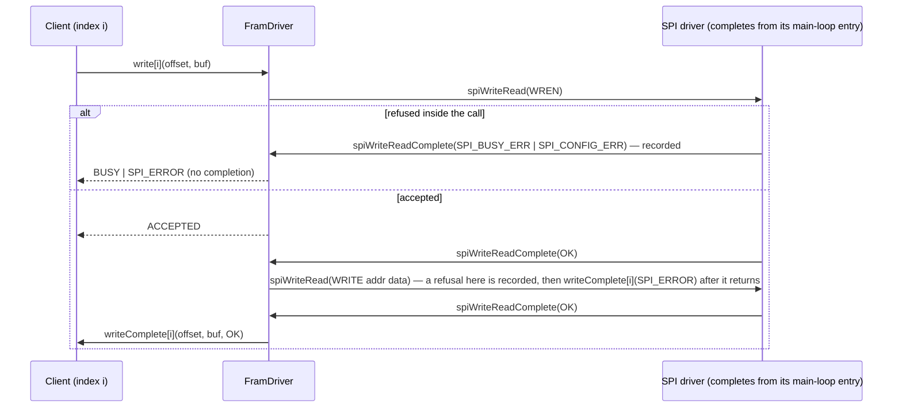

# Fram::FramDriver

## Introduction

`Fram::FramDriver` is a passive F Prime component that manages an Infineon CY15B102QN 2 Mb (256 K × 8) serial F-RAM
over the framework's asynchronous SPI interface (`Drv.AsyncGuardedSpi`). A client asks, on one of the component's client
port indices, for a read or a write of N bytes at a byte offset, where N is the size of the requester's buffer; the
component issues the SPI frames the device needs, the SPI driver completes them asynchronously, and the component reports the
outcome on the same client port index that made the request. It holds no copy of the memory and runs no periodic work.

A request is *accepted* or *rejected* when it is made. An accepted request is *in progress* from acceptance until its
completion is delivered; the startup device-ID and status-register reads (issued at the *startup entry* call, "startup"
for short) are transfers in progress in the same sense. Rejection checks apply in the order of Table 4.

Device identity. The expected RDID reply is a deployment configuration item (Table 1, EXPECTED_DEVICE_ID) so one
component serves the CY15B102QN family. Default = the reply of the bench device, `00 2A C2 7F×6` wire order, which datasheet
002-26764 Rev. *D (EXCELON LP) assigns to CY15B102QN-50SXI; the requested CY15B102QN-50SXE (002-19073 Rev. *O, EXCELON
Auto, printed MSB-first `…C22A60`) is selected by overriding the header with `60 2A C2 7F×6`. Both documents define the same
command set, address format and status register.

## Requirements

| ID | Requirement | Verification |
|---|---|---|
| <a id="REQ-FramDriver-001"></a>REQ-FramDriver-001 | The component shall read N bytes at a byte offset into the requester's buffer. | Unit Test |
| <a id="REQ-FramDriver-002"></a>REQ-FramDriver-002 | The component shall write N bytes at a byte offset from the requester's buffer. | Unit Test |
| <a id="REQ-FramDriver-003"></a>REQ-FramDriver-003 | Reads and writes shall follow datasheet 002-26764 Rev. *D command set and write-enable sequence. | Unit Test |
| <a id="REQ-FramDriver-004"></a>REQ-FramDriver-004 | An accepted request shall produce exactly one completion, on the port index that made it. | Unit Test |
| <a id="REQ-FramDriver-005"></a>REQ-FramDriver-005 | An accepted request's call shall return status ACCEPTED before its SPI transfer completes. | Unit Test |
| <a id="REQ-FramDriver-006"></a>REQ-FramDriver-006 | A request violating a limit of Table 1 shall be rejected with status OUT_OF_RANGE. | Unit Test |
| <a id="REQ-FramDriver-007"></a>REQ-FramDriver-007 | A request made while any transfer is in progress shall be rejected with status BUSY. | Unit Test |
| <a id="REQ-FramDriver-008"></a>REQ-FramDriver-008 | A rejected request shall report its status before the request call returns, without a completion. | Unit Test |
| <a id="REQ-FramDriver-009"></a>REQ-FramDriver-009 | An SPI error after the call returns shall complete the request SPI_ERROR, no further frames. | Unit Test |
| <a id="REQ-FramDriver-010"></a>REQ-FramDriver-010 | A request within or after a completion shall not be rejected BUSY under REQ-007. | Unit Test |
| <a id="REQ-FramDriver-011"></a>REQ-FramDriver-011 | A completion shall hand back the requester's buffer with its original pointer and size. | Unit Test |
| <a id="REQ-FramDriver-012"></a>REQ-FramDriver-012 | At startup entry the component shall read the device ID and compare with EXPECTED_DEVICE_ID (Table 1). | Unit Test |
| <a id="REQ-FramDriver-013"></a>REQ-FramDriver-013 | A device ID mismatch shall be reported by a WARNING_HI event; requests shall remain accepted. | Unit Test |
| <a id="REQ-FramDriver-014"></a>REQ-FramDriver-014 | A startup read SPI error shall raise WARNING_HI; remaining startup reads and requests continue. | Unit Test |
| <a id="REQ-FramDriver-015"></a>REQ-FramDriver-015 | At startup the component shall read the status register; BP1 or BP0 set (block protect: writes to the upper part of the array are silently discarded) raises WARNING_HI. | Unit Test |
| <a id="REQ-FramDriver-016"></a>REQ-FramDriver-016 | The component shall emit the Table 2 events not required by REQ-013 to REQ-015. | Unit Test |
| <a id="REQ-FramDriver-017"></a>REQ-FramDriver-017 | The component shall report the telemetry of Table 3. | Unit Test |
| <a id="REQ-FramDriver-018"></a>REQ-FramDriver-018 | The component shall own no thread and no message queue. | Inspection |
| <a id="REQ-FramDriver-021"></a>REQ-FramDriver-021 | An SPI-driver refusal inside the call shall reject BUSY if SPI_BUSY_ERR, else SPI_ERROR. | Unit Test |
| <a id="REQ-FramDriver-022"></a>REQ-FramDriver-022 | A write overlapping the block-protected range shall be rejected with status WRITE_PROTECTED. | Unit Test |
| <a id="REQ-FramDriver-023"></a>REQ-FramDriver-023 | Data written by the component shall read back equal after an MCU reset. | Inspection (one-off bench reset test L3-1) |

Table 1 — Constants (compile-time configuration)

| Name | Value | Meaning |
|---|---|---|
| FRAM_SIZE | 262144 | Addressable bytes, at most 2^24 (three address bytes); a request needs 1 ≤ N, offset ≤ FRAM_SIZE − N and a non-null buffer data pointer |
| FRAM_MAX_TRANSFER | 64 | Largest N per request (bounds the component's frame buffer); at least 6 so the 10-byte startup RDID frame fits |
| FRAM_CLIENT_PORTS | 2 | Number of client request/completion port pairs |
| EXPECTED_DEVICE_ID | configurable; default 00 2A C2 7F 7F 7F 7F 7F 7F | Expected 9-byte RDID reply in wire order (first byte received first), set per fitted family member: default = CY15B102QN-50SXI (002-26764 Rev. *D); CY15B102QN-50SXE = 60 2A C2 7F 7F 7F 7F 7F 7F |

Table 2 — Events

| Event | Severity | When |
|---|---|---|
| DeviceIdMismatch(id read: 9 bytes, wire order) | WARNING_HI | Startup RDID reply differs from EXPECTED_DEVICE_ID |
| StartupReadFailed(status: SPI driver status) | WARNING_HI | SPI driver completed a startup read with a non-OK status |
| BlockProtectSet(status register) | WARNING_HI | Startup status-register read shows BP1 or BP0 set — block protect: writes to the upper quarter / half / all of the array (datasheet Table 5) are silently discarded; reported, not cleared |
| RequestRejected(port, offset, N, status, cause) | WARNING_LO, throttled to 5 per boot | Request rejected BUSY, OUT_OF_RANGE or WRITE_PROTECTED (REQ-006, REQ-007, REQ-021 BUSY case, REQ-022); cause = TRANSFER_IN_PROGRESS, SPI_DRIVER_BUSY, REENTRANT_IN_CALL, OUT_OF_RANGE or WRITE_PROTECTED |
| SpiError(port, offset, N, status: SPI driver status, site) | WARNING_HI, throttled to 5 per boot | SPI driver reported a non-OK status for a client request's frame, by completion (REQ-009; site = READ_FRAME, WREN_FRAME or WRITE_FRAME) or inside the call (REQ-021 SPI_ERROR case; site = REQUEST_REFUSED) |
| StartupComplete | ACTIVITY_LO | Both startup reads have completed (with or without warnings); ground and test checkers may sequence on it |

Table 3 — Telemetry

| Channel | Type | Meaning |
|---|---|---|
| ReadsCompleted | U32 | Reads completed with status OK |
| WritesCompleted | U32 | Writes completed with status OK |
| RequestsRejected | U32 | Requests rejected BUSY, OUT_OF_RANGE or WRITE_PROTECTED |
| SpiErrors | U32 | Requests ended SPI_ERROR: by completion or by an SPI-driver refusal inside the call |
| StartupState | enum NOT_STARTED / IN_PROGRESS / COMPLETE / READ_FAILED | NOT_STARTED → IN_PROGRESS at startup entry → COMPLETE, or READ_FAILED if either read failed (set when StartupComplete is emitted; the failed read's channel is not updated) |
| DeviceIdMatch | bool | Startup RDID reply equalled EXPECTED_DEVICE_ID; not updated (stays false) if the read failed |
| StatusRegister | U8 | Status register as read at startup (BP1 = bit 3, BP0 = bit 2); not updated (stays 0) if the read failed |

Table 4 — Status values (returned by the request call; OK and SPI_ERROR also carried by a completion). Rejections are checked in the order BUSY, OUT_OF_RANGE, WRITE_PROTECTED.

| Status | Meaning |
|---|---|
| ACCEPTED | Request taken; exactly one completion is delivered on the requesting index |
| OK | Transfer completed, data valid |
| OUT_OF_RANGE | Request violated a Table 1 limit |
| BUSY | A transfer was in progress (this component's, or the SPI driver answered SPI_BUSY_ERR inside the call), or the request was issued from a completion that was itself delivered inside a `spiWriteRead` call (REENTRANT_IN_CALL, bounded recursion) |
| SPI_ERROR | The SPI driver reported an error for a frame of this request (by completion, or by the call when the SPI driver refused the first frame inside it with other than SPI_BUSY_ERR) |
| WRITE_PROTECTED | The write overlaps the block-protected range (BP1:BP0 read at startup; datasheet Table 5: 01 = 30000h–3FFFFh, 10 = 20000h–3FFFFh, 11 = all); if the startup status-register read failed the range is taken as empty |

Out-of-scope failure modes

| Failure mode | Why out of scope |
|---|---|
| Request from interrupt context | Deployment constraint: all clients run in main context |
| Completion before the request call returns, or a request from inside it (REQ-005, REQ-010) | Hold under the §Ports deployment constraint; otherwise the completion may precede ACCEPTED and the inner request is rejected BUSY (bounded) |
| Spurious or buffer-mismatched completion | SPI driver contract: one callback per request with its buffers |
| Completion that never arrives | SPI driver bus-error recovery; this component has no timeout |
| Device lost or replaced after startup | Undetectable over SPI (no acknowledgement); clients validate their data |
| Startup entry called twice or during a transfer | Topology calls it once, from the start sequence |
| MCU reset between the WREN and WRITE frames | Benign: only the device's WEL latch stays set (datasheet §4.1.1) |
| Request while the two startup reads are outstanding | Rejected BUSY; clients retry. Block protect is reported, never cleared (no WRSR) |
| Write before a successful status-register read | Protected range unknown, treated as empty: the device discards the write silently; StatusRegister = 0 with StartupState READ_FAILED flags it |

## Design

### Block diagram (special ports eventOut, textEventOut, tlmOut, timeGetOut omitted)
```
  Fram.Request [2]        read ■─┬───────────────────────────────┬─■ readComplete [2]      Fram.Complete
  Fram.Request [2]       write ■─┤  Fram.FramDriver  (passive)   ├─■ writeComplete [2]     Fram.Complete
  Drv.SpiWriteReadCallback       │                               ├─■ spiWriteRead          Drv.SpiWriteReadRequest
          spiWriteReadComplete ■─┴───────────────────────────────┘
```
### Ports
| Port | Kind | Type | Purpose |
|---|---|---|---|
| read | sync input [ClientPorts] | Fram.Request → Fram.Status | Accept or reject a read; one index per client |
| write | sync input [ClientPorts] | Fram.Request → Fram.Status | Accept or reject a write; one index per client |
| readComplete | output [ClientPorts], matched with read | Fram.Complete | Hand the buffer back on the requesting index |
| writeComplete | output [ClientPorts], matched with write | Fram.Complete | Hand the buffer back on the requesting index |
| spiWriteRead | output | Drv.SpiWriteReadRequest | Send one frame to the SPI driver's slot for this device |
| spiWriteReadComplete | sync input | Drv.SpiWriteReadCallback | Frame done: next frame, client completion, or in-call refusal |

Pattern: passive adapter, callback-chained state machine; request ports return a value, hence `sync`. Unguarded and
single-context by **deployment constraint**: a passive `Drv.AsyncGuardedSpi` driver completing from its own scheduler
entry in the clients' context (the port promises only "non-interrupt context"; `Samd21.SpiDriver` complies); `guarded`
would re-enter the non-recursive mutex under REQ-010. No commands, no parameters.

Design constraint: the library uses framework modules only (`Drv`, `Fw`) — no `fprime-samd` symbol; the
build entry gate checks it (native build of `Fram/` against `nasa/fprime` alone).

### Events and telemetry
| Event | Severity | Arguments |
|---|---|---|
| DeviceIdMismatch / StartupReadFailed / BlockProtectSet | WARNING_HI | deviceId: Fram.DeviceId (wire order) / read: Fram.StartupRead, status: Drv.SpiStatus / statusRegister: U8 |
| RequestRejected | WARNING_LO, throttle 5 | op, client, offset, length, status: BUSY / OUT_OF_RANGE / WRITE_PROTECTED, cause: Fram.RejectCause |
| SpiError | WARNING_HI, throttle 5 | op, client, offset, length, status: Drv.SpiStatus, site: Fram.SpiErrorSite |
| StartupComplete | ACTIVITY_LO | — (ground/checkers sequence on it; FSW clients retry on BUSY) |

| Channel | Type | Update |
|---|---|---|
| ReadsCompleted, WritesCompleted | U32, wrap modulo 2^32 (no assert, no saturation) | on each completion OK |
| RequestsRejected, SpiErrors | U32, wrap modulo 2^32 | on each rejection BUSY / OUT_OF_RANGE / WRITE_PROTECTED; on each SPI_ERROR outcome (completion or in-call refusal) |
| StartupState | Fram.StartupState | NOT_STARTED → IN_PROGRESS at startup() → COMPLETE, or READ_FAILED if either read failed (set with StartupComplete) |
| DeviceIdMatch, StatusRegister | bool, U8 | after the RDID / RDSR startup reads |

### Configure
Table 1 is the `Fram/FramConfig` configuration module; a deployment overrides it like `AsyncSpiCfg`:

```fpp
# FramConfig.fpp (deployment override)
module Fram { module FramConfig {
    constant Size = 262144      # 6 <= MaxTransfer <= Size <= 2^24, static_asserted
    constant MaxTransfer = 64
    constant ClientPorts = 2
    constant DeviceIdSize = 9   # fixed by the RDID reply, not a knob
} }
```
```cpp
// FramConfig.hpp (deployment override: full copy of the library file, only this line changes) — wire order, first byte received first
static constexpr U8 EXPECTED_DEVICE_ID[Fram::FramConfig::DeviceIdSize] =
    {0x00, 0x2A, 0xC2, 0x7F, 0x7F, 0x7F, 0x7F, 0x7F, 0x7F};   // -50SXI; -50SXE: first byte 0x60
```
```cmake
# <project>/config-overrides/CMakeLists.txt — not config/ or FramConfig/ (project root is an include root: shadowing)
register_fprime_config(
        MyProjectFramConfig
    CONFIGURATION_OVERRIDES
        "${CMAKE_CURRENT_LIST_DIR}/FramConfig.fpp"   # whole-file copies of the library defaults, same names
        "${CMAKE_CURRENT_LIST_DIR}/FramConfig.hpp"
    INTERFACE
)
# <project>/CMakeLists.txt: add_fprime_subdirectory("${CMAKE_CURRENT_LIST_DIR}/config-overrides/") after fprime_setup_included_code()
```
```fpp
# topology: one SPI slot, same index both ways; CS, mode 0, MSB-first, clock and pins are the SPI driver's configuration
framDriver.spiWriteRead -> spiDriver.SpiWriteRead[0]
spiDriver.SpiWriteReadComplete[0] -> framDriver.spiWriteReadComplete
```
```fpp
# instances.fpp — startTasks runs after configComponents has configured spiDriver
instance framDriver: Fram.FramDriver base id 0xDD00 {
    phase Fpp.ToCpp.Phases.startTasks """
    framDriver.startup();   // RDID then RDSR, once; a C++ entry because a passive-only topology has no start signal
    """
}
```

### Behavior
Request checks, in the call, in this order (no overflow):
1. BUSY — any transfer (client or startup) in progress.
2. OUT_OF_RANGE — `N == 0`, `N > MaxTransfer` or `offset > Size - N`.
3. WRITE_PROTECTED — a write overlapping the BP1:BP0 range from a successful startup RDSR (unknown range = empty, see Out-of-scope failure modes).

Frames, from component-owned transmit/receive buffers of `4 + MaxTransfer` bytes (the client's buffer never reaches the SPI
driver): read = `READ addr` with the received tail copied to the client's buffer; write = `WREN`, then `WRITE addr data`;
startup = `RDID`, then `RDSR`.

Re-entrant refusal: **every** `spiWriteRead` may complete before it returns. Each issuer (request handler, completion handler,
`startup()`) sets an *issuing* mark before the call; a completion arriving while it is set is only recorded, and the issuer
acts after the call returns as if the status had arrived later — request handler: reject BUSY (SPI_BUSY_ERR, `RequestRejected`)
or SPI_ERROR (`SpiError`, `SpiErrors++`) per REQ-021; completion handler: deliver SPI_ERROR (REQ-009); `startup()`: emit
`StartupReadFailed`, issue its next read — so startup may finish, `StartupComplete` included, before `startup()` returns,
and with a driver that completes inside the call a client's completion may be delivered before its request call returns
ACCEPTED (unreachable with a driver completing from its scheduler entry; clients must be ready before they call).
Nothing is issued or delivered from inside a re-entrant callback, and a request issued from a completion that was itself
delivered inside a `spiWriteRead` call — whichever handler made that call — is rejected BUSY (`REENTRANT_IN_CALL`) so that
the recursion is bounded. A client buffer with a null data pointer violates Table 1 (OUT_OF_RANGE).

Completion: a later callback issues the next frame or the client completion, idling the component first so a new request is
accepted even from inside that completion (REQ-010); a non-OK status ends the transfer with `SpiError` and a SPI_ERROR
completion. `startup()` emits the startup warnings as found and `StartupComplete` last.



## Unit-test list

| Test | Description | Requirements |
|---|---|---|
| ReadNominal | Read of N bytes at offset returns ACCEPTED, sends READ+addr frame, copies the reply tail into the caller's buffer | REQ-FramDriver-001, REQ-FramDriver-003, REQ-FramDriver-005 |
| WriteNominal | Write sends WREN then WRITE+addr+data from the caller's buffer, completes OK after the second frame | REQ-FramDriver-002, REQ-FramDriver-003, REQ-FramDriver-005 |
| CompletionPortIndex | Completion arrives once, on the requesting index, for every client index | REQ-FramDriver-004 |
| CompletionBufferIdentity | Completion hands back the caller's buffer with its original data pointer and size | REQ-FramDriver-011 |
| AcceptedBeforeComplete | Request call returns ACCEPTED while the SPI frame is still outstanding | REQ-FramDriver-005 |
| OutOfRangeLimits | N = 0, N = MaxTransfer + 1, offset = Size − N + 1 and offset near 2^32 are rejected OUT_OF_RANGE, no frame sent | REQ-FramDriver-006, REQ-FramDriver-008 |
| BusyWhileTransfer | Second request during a client transfer and during a startup read returns BUSY, no completion | REQ-FramDriver-007, REQ-FramDriver-008 |
| BusyBeforeOutOfRange | Request that is both busy and out of range returns BUSY | REQ-FramDriver-007 |
| SpiErrorAfterReturn | Non-OK frame status after return completes SPI_ERROR, emits SpiError, sends no further frame | REQ-FramDriver-009, REQ-FramDriver-016 |
| InCallRefusalBusy | SPI_BUSY_ERR delivered inside the request call rejects BUSY with RequestRejected, no completion | REQ-FramDriver-021, REQ-FramDriver-008 |
| InCallRefusalError | SPI_CONFIG_ERR delivered inside the request call rejects SPI_ERROR with SpiError, no completion | REQ-FramDriver-021, REQ-FramDriver-008 |
| InCallRefusalMidTransfer | Refusal inside the WRITE frame call delivers SPI_ERROR completion after that call returns | REQ-FramDriver-009 |
| RequestInsideCompletion | Request made from the completion callback is accepted and its frame is sent; from a completion delivered inside a request call it is rejected BUSY (REENTRANT_IN_CALL) | REQ-FramDriver-010 |
| RequestAfterCompletion | Request right after a completion is accepted | REQ-FramDriver-010 |
| StartupReads | startup() sends RDID then RDSR, sets StartupState, DeviceIdMatch, StatusRegister, emits StartupComplete | REQ-FramDriver-012, REQ-FramDriver-015, REQ-FramDriver-017 |
| StartupIdMismatch | Reply differing from EXPECTED_DEVICE_ID emits DeviceIdMismatch, DeviceIdMatch false, requests still accepted | REQ-FramDriver-013 |
| StartupReadFailed | Failed RDID still issues RDSR; failed RDSR still completes startup with READ_FAILED and StartupReadFailed | REQ-FramDriver-014 |
| StartupInCallRefusal | Startup frame refused inside startup() records StartupReadFailed and continues inside the call | REQ-FramDriver-014 |
| BlockProtectWarning | RDSR with BP1 or BP0 set emits BlockProtectSet and StatusRegister | REQ-FramDriver-015 |
| WriteProtectedRange | Writes overlapping each BP1:BP0 range are rejected WRITE_PROTECTED; reads and non-overlapping writes pass | REQ-FramDriver-022 |
| WriteProtectedUnknownRange | After a failed RDSR every in-range write is accepted | REQ-FramDriver-022 |
| TelemetryCounters | ReadsCompleted, WritesCompleted, RequestsRejected, SpiErrors count each outcome and wrap at 2^32 | REQ-FramDriver-017 |
| EventsRequestRejected | RequestRejected carries op, client, offset, length, status, cause for each rejection kind and throttles at 5 | REQ-FramDriver-016 |
| EventsSpiError | SpiError carries op, client, offset, length, driver status, site and throttles at 5 | REQ-FramDriver-016 |
| OutOfRangeBeforeWriteProtected | Write past Size into a BP range returns OUT_OF_RANGE, not WRITE_PROTECTED | REQ-FramDriver-006, REQ-FramDriver-022 |
| InCallOkCompletion | SPI_OK delivered inside the request call issues the next frame / completion after the call returns | REQ-FramDriver-004, REQ-FramDriver-010 |
| InCallOkThenRefusal | WREN completes OK inside the call and the chained WRITE is refused inside the same call: SPI_ERROR completion (site WRITE_FRAME) delivered before ACCEPTED returns | REQ-FramDriver-009, REQ-FramDriver-021 |
| UnsolicitedCompletionAsserts | A completion with nothing outstanding is a peer-contract breach and asserts | REQ-FramDriver-009 |
| StartupTwiceAsserts | startup() called twice, or while a startup read is outstanding, asserts | REQ-FramDriver-012 |
| StartupDuringClientTransferAsserts | startup() while a client transfer is outstanding asserts | REQ-FramDriver-012 |
| NullBufferRejected | A client buffer with a null data pointer is rejected OUT_OF_RANGE on both ports, no frame | REQ-FramDriver-006 |
| ReentrantFromHandlerDrain | WRITE frame completing inside the completion-handler call: the client's completion is delivered from that handler and its re-entrant request is rejected BUSY (REENTRANT_IN_CALL) | REQ-FramDriver-010 |
| RandomSequence | 2000-step random walk over both ports (op, offset, N, SPI status) against a shadow model of idle/busy and the BP range; checks every status, frame, completion payload and read-back; both throttles | REQ-FramDriver-001, REQ-FramDriver-002, REQ-FramDriver-004, REQ-FramDriver-006, REQ-FramDriver-007, REQ-FramDriver-009, REQ-FramDriver-010, REQ-FramDriver-011, REQ-FramDriver-017, REQ-FramDriver-022 |

## Tests

| Test | Description | Requirements |
|---|---|---|
| L0-1 | Standing telemetry shows startup complete, device ID matched, block protect clear | REQ-FramDriver-012, REQ-FramDriver-015, REQ-FramDriver-017 |
| L0-2 | Harness marker command round-trips as one event | — |
| L2-1 | 64-byte write at offset 0 reads back equal on the same client port | REQ-FramDriver-001, 002, 003, 004, 011 |
| L2-2 | Last 64 bytes read back equal; one-past-end read rejected OUT_OF_RANGE | REQ-FramDriver-001, 002, 006, 008 |
| L2-3 | Completions return on the requesting client index | REQ-FramDriver-004, 011 |
| L2-5 | Whole device written and verified in 64-byte chunks | REQ-FramDriver-001, 002 |
| L3-1 | Data written before an MCU reset reads back equal after it — one-off, verification method Inspection | REQ-FramDriver-023 |
| L5-1 | Second request during a transfer is rejected BUSY, no completion | REQ-FramDriver-007, 008 |
| L5-2 | Zero-length and over-size requests rejected OUT_OF_RANGE, no completion | REQ-FramDriver-006, 008, 016 |
| L5-3 | Request issued from inside a completion is accepted | REQ-FramDriver-010 |
| L6-1 | Verifier reports 64 mismatches for a wrong pattern (negative control) | — |
| L7-1 | Known pseudo-random image left at 0x3FF00 for the auditor's dump | REQ-FramDriver-001, 002 |
| UT rows above | Unit tests of the Unit-test list | REQ-FramDriver-005, 009, 013, 014, 021, 022 have unit tests only (plan W1/W2) |
| Inspection | No thread/queue | REQ-FramDriver-018 |
| Build entry gate | Library builds against nasa/fprime alone (design constraint) | — |
