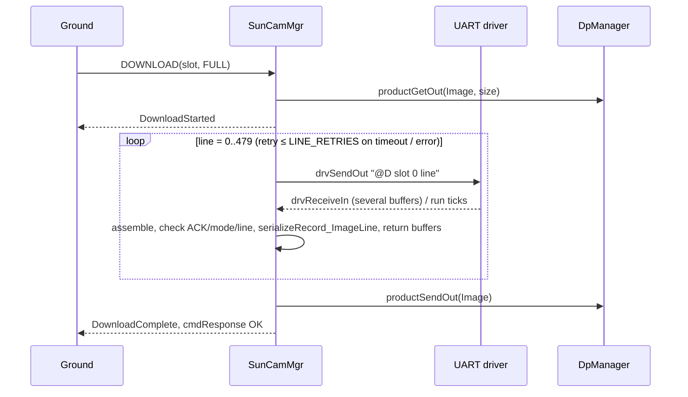

# KissCam::SunCamMgr

## Introduction

`KissCam::SunCamMgr` is an active F Prime component that manages an MVP Aerospace KissCAM V2 sun camera over a UART
byte-stream driver (115200 baud, 8N1, set by the deployment). It turns ground commands into the camera's seven-byte
command frames, parses the camera's reply frames, reflects the camera's reported mode, exposure, counters and memory
status in telemetry and events, applies the persisted camera settings (Table 1) at set-up, and delivers each image
readout as one F Prime data product. A camera operation is one `SETUP_CAMERA`, one Table 1 push with its follow-ups, one whole `DOWNLOAD`, or
one other command/reply exchange; at most one operation is in progress at a time. The camera is powered by another component, so the operator calls
`SETUP_CAMERA` once it is on; until then the component is NOT_SETUP.

Device identity: KissCAM V2 Datasheet and User Manual, Revision 1.1 (April 2023). Bench unit on `/dev/ttyUSB0`
(FTDI USB-RS422 cable FTAQMGVF): Ping reply `40 50 00 00 04 01 00 94 d1 0d` = ACK `P`, mode Sleep, 1 valid / 0 invalid
commands, uptime 38097 s — the datasheet's §7.4.1 reply format. The datasheet's Write Register command is not used.

## Requirements

| ID | Requirement | Verification |
|---|---|---|
| REQ-SunCamMgr-001 | Commands sent and replies parsed shall comply with KissCAM V2 Datasheet Rev. 1.1 §7. | Unit Test |
| REQ-SunCamMgr-002 | Camera frames shall be sent only for a Table 2 command or Table 1 push. | Unit Test |
| REQ-SunCamMgr-003 | `SETUP_CAMERA` shall run the Table 2 set-up exchanges in order, then become READY. | Unit Test |
| REQ-SunCamMgr-004 | A failed set-up exchange shall return the component to NOT_SETUP with a WARNING_HI event. | Unit Test |
| REQ-SunCamMgr-005 | `SETUP_CAMERA` shall be accepted in NOT_SETUP and READY. | Unit Test |
| REQ-SunCamMgr-006 | `SLEEP` and `PING` shall be accepted in NOT_SETUP and READY. | Unit Test |
| REQ-SunCamMgr-007 | `SLEEP` shall command camera mode Sleep and return the component to NOT_SETUP. | Unit Test |
| REQ-SunCamMgr-008 | Table 2 commands marked READY shall be rejected with a WARNING_LO event when not READY. | Unit Test |
| REQ-SunCamMgr-009 | A command except `DOWNLOAD_ABORT` during an operation shall be rejected BUSY with a WARNING_LO event. | Unit Test |
| REQ-SunCamMgr-010 | Table 1 parameters changed while READY shall be pushed when no operation is in progress. | Unit Test |
| REQ-SunCamMgr-011 | A failed parameter push shall return the component to NOT_SETUP with a WARNING_HI event. | Unit Test |
| REQ-SunCamMgr-012 | Exposure shall be read back from register 0x3012 after every exposure push and reported. | Unit Test |
| REQ-SunCamMgr-013 | `CAPTURE` shall send Capture with the commanded slot and test-pattern flag, reporting the returned exposure. | Unit Test |
| REQ-SunCamMgr-014 | `DOWNLOAD` shall request every line of the given slot, full or preview resolution, in order. | Unit Test |
| REQ-SunCamMgr-015 | A download shall produce one data product: Table 4 header, then one record per line. | Unit Test |
| REQ-SunCamMgr-016 | A failed or timed-out line reply shall be retried LINE_RETRIES times before the download aborts. | Unit Test |
| REQ-SunCamMgr-017 | An aborted download shall deliver lines received, if a product exists, with a WARNING_LO event. | Unit Test |
| REQ-SunCamMgr-018 | No reply within REPLY_TIMEOUT_TICKS `run` ticks shall fail the exchange with a WARNING_HI event. | Unit Test |
| REQ-SunCamMgr-019 | A camera error reply shall raise a WARNING_HI event carrying command, error type and count. | Unit Test |
| REQ-SunCamMgr-020 | Out-of-operation, malformed or wrong-command frames shall be discarded and counted with a WARNING_LO event. | Unit Test |
| REQ-SunCamMgr-021 | While READY, a reply mode ≠ commanded mode shall cause NOT_SETUP with a WARNING_HI event. | Unit Test |
| REQ-SunCamMgr-022 | The component shall report the Table 3 telemetry from the source named for each channel. | Unit Test |
| REQ-SunCamMgr-023 | Every command outcome and every Table 1 setting applied shall be reported by an event. | Unit Test |
| REQ-SunCamMgr-024 | A UART send or data-product allocation failure shall end the operation with a WARNING_HI event. | Unit Test |
| REQ-SunCamMgr-025 | Table 2 commands shall run their exchange and report the reply by event and telemetry. | Unit Test |
| REQ-SunCamMgr-026 | `DOWNLOAD_ABORT` with no download in progress shall be rejected with a WARNING_LO event. | Unit Test |
| REQ-SunCamMgr-027 | A CAMERA_MODE push shall be followed by an EXPOSURE push and its readback. | Unit Test |
| REQ-SunCamMgr-028 | An exposure readback differing from the pushed value shall cause NOT_SETUP with a WARNING_HI event. | Unit Test |
| REQ-SunCamMgr-029 | A full queue shall drop the newest input: buffer returned, command answered BUSY, WARNING_HI event. | Unit Test |

Table 1 — Parameters (persisted camera settings, pushed at set-up and on change)

| Parameter | Type / range | Default | Camera command |
|---|---|---|---|
| CAMERA_MODE | enum SD, HD | SD | Set Mode (`M`) |
| EXPOSURE | U16, 2..960 steps of 89.5 µs | 672 | Set Exposure (`E`) |

Table 2 — Commands (ground operations)

| Command | Arguments | Needs READY | Camera exchange(s) |
|---|---|---|---|
| SETUP_CAMERA | — | no | set-up exchanges, in order: Ping MCU, Set Mode, Set Exposure, Read Register 0x3012, Ping MCU+sensor |
| SLEEP | — | no | Set Mode Sleep |
| PING | type: MCU, MCU_AND_SENSOR | no | Ping |
| MEMORY_STATUS | — | yes | Memory Status |
| CAPTURE | slot: SLOT_1..SLOT_4, testPattern: OFF/ON | yes | Capture |
| DOWNLOAD | slot: SLOT_1..SLOT_4, resolution: FULL/PREVIEW | yes | Download × 480 (full) or × 60 (preview) |
| DOWNLOAD_ABORT | — | no (accepted only during a download) | none; the download stops after the pending line |
| READ_REGISTER | address U16 | yes | Read Register |

Table 3 — Telemetry

| Channel | Type | Source |
|---|---|---|
| SetupState | enum NOT_SETUP, SETTING_UP, READY | component state |
| CurrentOperation | enum NONE, SETUP_CAMERA, SLEEP, PING, MEMORY_STATUS, CAPTURE, DOWNLOAD, READ_REGISTER, PARAMETER_PUSH | component state (NONE when no operation is in progress) |
| CameraMode | enum SLEEP, SD, HD | mode byte of every reply |
| Exposure | U16 | EXPOSURE value whose Set Exposure was acknowledged; Capture reply exposure |
| ExposureReadback | U16 | Read Register 0x3012 reply |
| CameraUptime | U16 s | Ping reply |
| RegisterValue | {address, value} | Read Register reply |
| CameraValidCmds, CameraInvalidCmds | U8 | Ping / error replies |
| MemorySlots | array[4] of {mode, exposure, uptime} | Memory Status reply |
| LastCameraError | {command, errorType, count} | error reply |
| Exchanges, CameraErrors, Timeouts, DiscardedBytes, MalformedReplies | U32 | component counters |
| ImagesCaptured, LinesDownloaded, ProductsSent, QueueOverflows | U32 | component counters |

Table 4 — Constants and data-product records

| Name | Value | Meaning |
|---|---|---|
| REPLY_TIMEOUT_TICKS | 20 (configurable) | `run` ticks allowed per camera reply (datasheet: 2000 ms) |
| LINE_RETRIES | 3 (configurable) | re-requests of one image line before the download aborts |
| ImageHeader record | slot, resolution, width, height, cameraMode, linesExpected | first record of every image product; `cameraMode` = mode byte of the Download replies (camera mode at download time); the image's capture mode is the slot's Memory Status mode — an HD image is four slot products |
| ImageLine record | U8 array: line number (2 bytes, MSB first) then 640 or 80 pixels | one record per line received, camera byte order |

## Design

### Block diagram
```
 drvConnected : Drv.ByteStreamReady ─▶┌─────────────────────────────┐─▶ drvSendOut : Drv.ByteStreamSend
 drvReceiveIn : Drv.ByteStreamData  ─▶│     KissCam.SunCamMgr       │─▶ drvReceiveReturnOut : Fw.BufferSend
 run : Svc.Sched                    ─▶│          (active)           │─▶ pingOut : Svc.Ping
 pingIn : Svc.Ping                  ─▶└─────────────────────────────┘─▶ productGetOut, productSendOut (data products)
```
### Ports
| Port | Kind | Type | Purpose |
|---|---|---|---|
| drvConnected | async input, `drop` | Drv.ByteStreamReady | driver ready; handler empty, no state kept |
| drvReceiveIn | async input, `hook` | Drv.ByteStreamData | camera bytes; async (not the sync `ByteStreamDriverClient` import) so framing runs on the component thread |
| drvReceiveReturnOut | output | Fw.BufferSend | return driver receive buffers |
| drvSendOut | output | Drv.ByteStreamSend | send a 7-byte frame from the component's buffer |
| run | async input, `hook` | Svc.Sched | tick: reply timeouts, deferred parameter push |
| pingIn / pingOut | async input `hook` / output | Svc.Ping | health ping |
| productGetOut / productSendOut | product get / send | — | allocate and deliver the Image container |

Special ports: cmdIn/cmdRegOut/cmdResponseOut, eventOut/textEventOut, tlmOut, timeGetOut, prmGetOut/prmSetOut. All eight
commands (Table 2) are `async` with queue-full `hook`. Hooks run in the caller's thread and do only this: a command hook
answers `cmdResponse BUSY`, the `drvReceiveIn` hook returns the buffer, and every hook increments its source's
mutex-guarded drop count (one per `QueueInput`) — no other member is touched; on its next tick the component thread emits
one `QueueOverflow(source, dropped)` per non-zero source and adds the sum to `QueueOverflows` (REQ-029). Parameters are Table 1; telemetry is Table 3, one channel per FPP row with units in
the doc-comment; data-product records are Table 4 (`ImageHeader` struct, `ImageLine` `U8 array`, container `Image`).

### Events
| Event (args) | Severity | When |
|---|---|---|
| SetupStarted | ACTIVITY_LO | SETUP_CAMERA accepted |
| SetupComplete(mode, exposure) | ACTIVITY_HI | last set-up exchange acknowledged; READY |
| SetupFailed(step, cause) | WARNING_HI | a set-up exchange failed; NOT_SETUP |
| SettingApplied(setting, value) | ACTIVITY_HI | Set Mode / Set Exposure acknowledged |
| SettingPushFailed(setting, cause) | WARNING_HI | push outside set-up failed; NOT_SETUP |
| ExposureReadback(pushed, readback) | ACTIVITY_LO | register 0x3012 read after an exposure push |
| SleepEntered | ACTIVITY_HI | Set Mode Sleep acknowledged; NOT_SETUP |
| PingReply(pingType, validCmds, invalidCmds, uptime) | ACTIVITY_LO | Ping acknowledged |
| MemoryStatusReply(slots) | ACTIVITY_LO | Memory Status acknowledged |
| CaptureComplete(slot, testPattern, exposure, mode) | ACTIVITY_HI | Capture acknowledged (slot as sent; in HD the camera used all four) |
| DownloadStarted(slot, resolution, lines) | ACTIVITY_LO | DOWNLOAD accepted, product allocated |
| DownloadComplete(slot, resolution, lines, bytes) | ACTIVITY_HI | last line stored, product sent |
| DownloadAborted(slot, linesReceived, cause) | WARNING_LO | download ended early (COMMANDED, LINE_FAILED, SEND_FAILED, PRODUCT_FULL) |
| LineRetry(line, attempt) | DIAGNOSTIC | a line is re-requested |
| RegisterRead(address, value) | ACTIVITY_HI | Read Register acknowledged |
| CommandRejected(operation, cause) | WARNING_LO | NOT_READY, BUSY, NO_DOWNLOAD; response EXECUTION_ERROR (BUSY for cause BUSY) |
| CameraError(operation, cmdByte, errorType, count) | WARNING_HI | 0xFF reply |
| ReplyTimeout(operation, cmdByte) | WARNING_HI | REPLY_TIMEOUT_TICKS elapsed |
| FrameDiscarded(cause, bytes, head), throttle 10 | WARNING_LO | NO_OPERATION, MALFORMED, WRONG_COMMAND; first 8 bytes kept |
| ModeMismatch(commanded, reported) | WARNING_HI | reply mode ≠ commanded while READY; NOT_SETUP |
| SendFailed(operation, status) | WARNING_HI | driver refused the frame |
| ProductAllocationFailed(bytes) | WARNING_HI | no Image container of the needed size |
| QueueOverflow(source, dropped), throttle 10 | WARNING_HI | drops counted by the hooks since the last tick (COMMAND, UART_RECEIVE, RUN_TICK, HEALTH_PING) |

### Configure
`KissCamConfig` is a `register_fprime_config` module; a deployment overrides `KissCamConfig.fpp` through its config
directory. `run` is driven at 10 Hz so that REPLY_TIMEOUT_TICKS × period = 2 s (datasheet §7); a deployment with another
rate re-sets the constant to keep ≈ 2 s. The deployment opens the UART at 115200 8N1 with 1024-byte receive buffers.
```fpp
constant REPLY_TIMEOUT_TICKS = 20   # run ticks per reply (2 s at 10 Hz)
constant LINE_RETRIES = 3           # re-requests of one line before the download aborts
constant IMAGE_DP_PRIORITY = 10     # default priority of the Image container
instance sunCamMgr: KissCam.SunCamMgr base id 0x... queue size 64 stack size 65536 priority 100
```
Image container size per DOWNLOAD: `Header::SIZE + 2·hash + SIZE_OF_ImageHeader_RECORD + lines × SIZE_OF_ImageLine_RECORD
(2 + pixels)` ≈ 312 KB full, ≈ 5.5 KB preview; the data-product buffer manager needs one bin ≥ 320 KB. Each queued receive
holds one UART pool buffer, so while pool buffers are available UART_RECEIVE cannot by itself overflow a queue sized ≥ pool
depth + pending command, tick and ping messages; the driver's 50 ms null-buffer notices after pool exhaustion, and any other
overflow, fall back to: dropped buffers returned, reply fails as malformed, line retried. Pool depth and queue size are set from
the bench-measured buffers-per-reply N (stage 2) with 2× margin, independent of task priorities (Linux honours them only
with RT scheduling rights); download durations and sequence timeouts are deployment matters (topology SDD).
REPLY_TIMEOUT_TICKS and LINE_RETRIES are compile-time by design: the timeout is the datasheet's fixed 2000 ms, LINE_RETRIES
only bounds an abort the operator can re-command; both are deployment overrides, not flight parameters.

### Behavior
A command is checked against Table 2 and `CurrentOperation`; a refusal emits `CommandRejected`, otherwise it becomes the
operation in progress, its first 7-byte frame leaves on `drvSendOut` from the component's own buffer, and its command
response is deferred to the operation's end (DOWNLOAD FULL ≈ 30 s nominal, PREVIEW ≈ 1 s, worst case lines ×
(LINE_RETRIES + 1) × 2 s; sequence timeouts are set in the topology SDD); SLEEP ends in NOT_SETUP either way and its reply
is exempt from the mode check. Receive buffers with status OP_OK are appended to a component-local 648-byte assembler
(rather than `Svc.FrameAccumulator`, whose `ComDataWithContext` ports would need an adapter and a second topology
component), others are returned and counted as discarded, and a reply is complete when the length field (excluding the
final 0x0D; image payloads may contain 0x0D) is satisfied. A complete reply is matched to the outstanding command byte and
to every parameter it echoes (Download line number, Read Register address) — a mismatch, or a reply after its exchange
timed out, is discarded (WRONG_COMMAND / NO_OPERATION; replies carry no sequence number, so a late reply to a re-sent
command of the same byte and echo is indistinguishable) — then mode-checked and decoded into events and channels. `run`
ticks count a per-exchange timeout; on expiry or a 0xFF reply the exchange fails and the operation ends per the
requirements (set-up/push → NOT_SETUP; download line → `LineRetry`, then abort), while a download allocates its product
first, adds one `ImageLine` record per reply and sends the product on completion or abort. `parameterUpdated` only sets a
guarded dirty flag; the `run` handler pushes while idle (`CAMERA_MODE`, then `EXPOSURE` + readback), and on its first tick
the component reports SetupState NOT_SETUP, CurrentOperation NONE and zero counters (camera-sourced channels appear only
after a reply). Implementation obligations, verified by unit test: readback compared with the exposure value sent; both
parameters read once per push; assembler never indexes past 648 bytes and resyncs on 0x40; per-exchange count-down.


Out-of-scope failure modes
| Failure | Owner |
|---|---|
| Camera power off / power cycling | the power-control component; operator re-runs SETUP_CAMERA |
| Camera health while idle | operator PING (REQ-002: no autonomous frames); a power-cycle shows as ModeMismatch at the next exchange |
| Serial device missing, wrong baud, driver read errors | Drv.PosixUartDriver and the deployment |
| Data-product storage, cataloguing and downlink | Svc.DpManager / DpWriter / DpCatalog |
