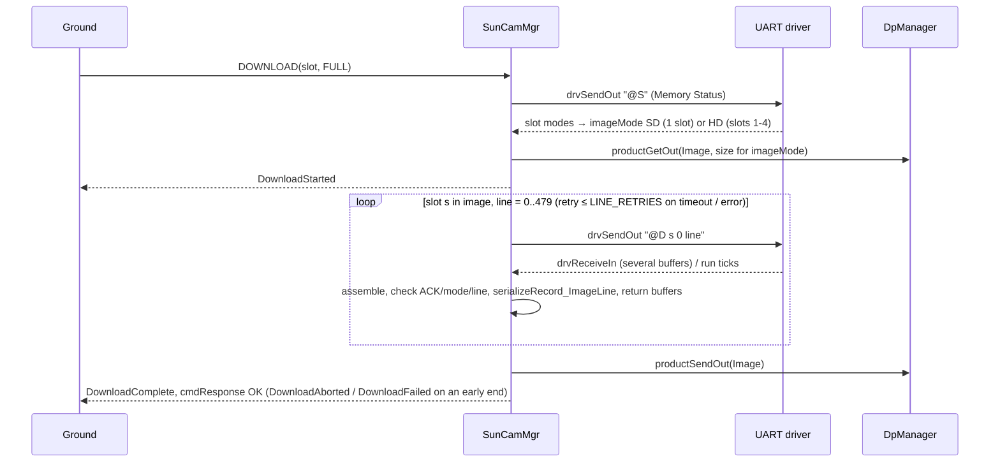

# KissCam::SunCamMgr

## Introduction

`KissCam::SunCamMgr` is an active F Prime component that manages an MVP Aerospace KissCAM V2 sun camera over a UART
byte-stream driver (115200 baud, 8N1, set by the deployment). It turns ground commands into the camera's seven-byte
command frames, parses the camera's reply frames, reflects the camera's reported mode, exposure, counters and memory
status in telemetry and events, applies the persisted camera settings (Table 1) at set-up, and delivers each image
readout as one F Prime data product (an HD image, stored by the camera across its four slots, is one product). A camera operation is one `SETUP_CAMERA`, one Table 1 push with its follow-ups, one whole `DOWNLOAD`, or
one other command/reply exchange; at most one operation is in progress at a time. The camera is powered by another component, so the operator calls
`SETUP_CAMERA` once it is on; until then the component is NOT_SETUP.

Device identity: KissCAM V2 Datasheet and User Manual, Revision 1.1 (April 2023). Bench unit on `/dev/ttyUSB0`
(FTDI USB-RS422 cable FTAQMGVF): Ping reply `40 50 00 00 04 01 00 94 d1 0d` = ACK `P`, mode Sleep, 1 valid / 0 invalid
commands, uptime 38097 s — the datasheet's §7.4.1 reply format. The datasheet's Write Register command is not used.

## Requirements

| ID | Requirement | Verification |
|---|---|---|
| REQ-SunCamMgr-001 | Commands sent and replies parsed shall comply with KissCAM V2 Datasheet Rev. 1.1 §7. | Unit Test |
| REQ-SunCamMgr-002 | Camera frames shall be sent only for a Table 2 command or Table 1 push. | Unit Test |
| REQ-SunCamMgr-003 | `SETUP_CAMERA` shall run the Table 2 set-up exchanges in order, then become READY. | Unit Test |
| REQ-SunCamMgr-004 | A failed set-up step shall return the component to NOT_SETUP with a WARNING_HI event. | Unit Test |
| REQ-SunCamMgr-005 | `SETUP_CAMERA` shall be accepted in NOT_SETUP and READY. | Unit Test |
| REQ-SunCamMgr-006 | `SLEEP` and `PING` shall be accepted in NOT_SETUP and READY. | Unit Test |
| REQ-SunCamMgr-007 | `SLEEP` shall command camera mode Sleep and return the component to NOT_SETUP. | Unit Test |
| REQ-SunCamMgr-008 | Table 2 commands marked READY shall be rejected with a WARNING_LO event when not READY. | Unit Test |
| REQ-SunCamMgr-009 | A command except `DOWNLOAD_ABORT` during an operation shall be rejected BUSY with a WARNING_LO event. | Unit Test |
| REQ-SunCamMgr-010 | Table 1 parameters changed while READY shall be pushed when no operation is in progress. | Unit Test |
| REQ-SunCamMgr-011 | A failed parameter push shall return the component to NOT_SETUP with a WARNING_HI event. | Unit Test |
| REQ-SunCamMgr-012 | Exposure shall be read back from register 0x3012 after every exposure push and reported. | Unit Test |
| REQ-SunCamMgr-013 | `CAPTURE` shall send Capture with the commanded slot and test-pattern flag, reporting the returned exposure. | Unit Test |
| REQ-SunCamMgr-014 | `DOWNLOAD` shall request every line of the image — all four slots when HD — in order. | Unit Test |
| REQ-SunCamMgr-015 | A download shall produce one data product per image: Table 4 header, then line records. | Unit Test |
| REQ-SunCamMgr-016 | A failed or timed-out line reply shall be retried LINE_RETRIES times before the download fails. | Unit Test |
| REQ-SunCamMgr-017 | A download ended early shall deliver lines received: ACTIVITY_HI event if commanded, WARNING_HI otherwise. | Unit Test |
| REQ-SunCamMgr-018 | No reply within REPLY_TIMEOUT_TICKS `run` ticks shall fail the exchange with a WARNING_HI event. | Unit Test |
| REQ-SunCamMgr-019 | A camera error reply shall raise a WARNING_HI event carrying command, error type and count. | Unit Test |
| REQ-SunCamMgr-020 | Out-of-operation, malformed or wrong-command frames shall be discarded and counted with a WARNING_LO event. | Unit Test |
| REQ-SunCamMgr-021 | While READY, a reply mode ≠ commanded mode shall cause NOT_SETUP with a WARNING_HI event. | Unit Test |
| REQ-SunCamMgr-022 | The component shall report the Table 3 telemetry from the source named for each channel. | Unit Test |
| REQ-SunCamMgr-023 | Every command outcome and every Table 1 setting applied shall be reported by an event. | Unit Test |
| REQ-SunCamMgr-024 | A UART send or data-product allocation failure shall end the operation with a WARNING_HI event. | Unit Test |
| REQ-SunCamMgr-025 | Table 2 commands shall run their exchange and report the reply by event and telemetry. | Unit Test |
| REQ-SunCamMgr-026 | `DOWNLOAD_ABORT` with no download in progress shall be rejected with a WARNING_LO event. | Unit Test |
| REQ-SunCamMgr-027 | A CAMERA_MODE push shall be followed by an EXPOSURE push and its readback. | Unit Test |
| REQ-SunCamMgr-028 | An exposure readback differing from the pushed value shall cause NOT_SETUP with a WARNING_HI event. | Unit Test |
| REQ-SunCamMgr-029 | A full queue shall drop the newest input: buffer returned, command answered BUSY, WARNING_HI event. | Unit Test |
| REQ-SunCamMgr-030 | Component state and counter channels shall be written on change and every TLM_PERIOD_TICKS `run` ticks. | Unit Test |
| REQ-SunCamMgr-031 | An out-of-range EXPOSURE shall send no frame: a push is refused with a WARNING_LO event, READY kept. | Unit Test |
| REQ-SunCamMgr-032 | A download whose Memory Status shows no SD image, or an incomplete HD image, shall end with a WARNING_HI event. | Unit Test |

Table 1 — Parameters (persisted camera settings, pushed at set-up and on change)

| Parameter | Type / range | Default | Camera command |
|---|---|---|---|
| CAMERA_MODE | enum SD = 1, HD = 2 (the Set Mode byte, §7.4.2) | SD | Set Mode (`M`) |
| EXPOSURE | U16, EXPOSURE_MIN..EXPOSURE_MAX (2..960) steps of 89.5 µs, checked by the component (§7.4.4) | 672 | Set Exposure (`E`) |

Table 2 — Commands (ground operations)

| Command | Arguments | Needs READY | Camera exchange(s) |
|---|---|---|---|
| SETUP_CAMERA | — | no | set-up steps, in order: Ping MCU, Set Mode, Set Exposure (preceded by the local EXPOSURE range check), Read Register 0x3012, Ping MCU+sensor |
| SLEEP | — | no | Set Mode Sleep |
| PING | type: MCU, MCU_AND_SENSOR | no | Ping |
| MEMORY_STATUS | — | yes | Memory Status |
| CAPTURE | slot: SLOT_1..SLOT_4, testPattern: OFF/ON | yes | Capture |
| DOWNLOAD | slot: SLOT_1..SLOT_4, resolution: FULL/PREVIEW | yes | Memory Status, then Download × 480 (full) or × 60 (preview) per slot — the one slot of an SD image, slots 1-4 in order of an HD image |
| DOWNLOAD_ABORT | — | no (accepted only during a download) | none; the download stops after the pending line |
| READ_REGISTER | address U16 | yes | Read Register |

Table 3 — Telemetry

| Channel | Type | Source |
|---|---|---|
| SetupState | enum NOT_SETUP, SETTING_UP, READY | component state |
| CurrentOperation | enum NONE, SETUP_CAMERA, SLEEP, PING, MEMORY_STATUS, CAPTURE, DOWNLOAD, READ_REGISTER, PARAMETER_PUSH | component state (NONE when no operation is in progress) |
| CameraMode | enum SLEEP = 0, SD = 1, HD = 2 (the reply mode byte, §7.2) | mode byte of every reply |
| Exposure | U16 | EXPOSURE value whose Set Exposure was acknowledged; Capture reply exposure |
| ExposureReadback | U16 | Read Register 0x3012 reply |
| CameraUptime | U16 s | Ping reply |
| RegisterValue | {address, value} | Read Register reply |
| CameraValidCmds, CameraInvalidCmds | U8 | Ping / error replies |
| MemorySlots | array[4] of {mode (same enum), exposure, uptime} | Memory Status reply |
| LastCameraError | {command, errorType, count} | error reply |
| Exchanges, CameraErrors, Timeouts, DiscardedBytes, MalformedReplies | U32 | component counters |
| ImagesCaptured, LinesDownloaded, ProductsSent, QueueOverflows | U32 | component counters |

Table 4 — Constants and data-product records

| Name | Value | Meaning |
|---|---|---|
| REPLY_TIMEOUT_TICKS | 20 (configurable) | `run` ticks allowed per camera reply (datasheet: 2000 ms) |
| LINE_RETRIES | 3 (configurable) | re-requests of one image line before the download fails |
| TLM_PERIOD_TICKS | 10 (configurable) | `run` ticks between periodic writes of the component state and counter channels (1 s at 10 Hz) |
| EXPOSURE_MIN, EXPOSURE_MAX | 2, 960 | EXPOSURE values the component sends (datasheet §7.4.4) |
| ImageHeader record | slot, imageMode, resolution, width, height, cameraMode, linesExpected | first record of every image product; `imageMode` = the slot's Memory Status mode (SD: one slot, HD: four quadrant slots); `cameraMode` = mode byte of the Download replies; width × height = 640×480 / 80×60 (SD), 1280×960 / 160×120 (HD) |
| ImageLine record | U8 array: slot (1 byte), line number (2 bytes, MSB first), then 640 or 80 pixels | one record per line received, camera byte order; HD records run slot 1, 2, 3, 4 (quadrants top-left, top-right, bottom-left, bottom-right, datasheet Figure 3) |

## Design

### Block diagram
```
 drvConnected : Drv.ByteStreamReady ─▶┌─────────────────────────────┐─▶ drvSendOut : Drv.ByteStreamSend
 drvReceiveIn : Drv.ByteStreamData  ─▶│     KissCam.SunCamMgr       │─▶ drvReceiveReturnOut : Fw.BufferSend
 run : Svc.Sched (sync → atomic → runInternal) ─▶│   (active)        │─▶ pingOut : Svc.Ping
 pingIn : Svc.Ping                  ─▶└─────────────────────────────┘─▶ productGetOut, productSendOut (data products)
```
### Ports
| Port | Kind | Type | Purpose |
|---|---|---|---|
| drvConnected | async input, `drop` | Drv.ByteStreamReady | driver ready; handler empty, no state kept |
| drvReceiveIn | async input, `hook` | Drv.ByteStreamData | camera bytes; async (not the sync `ByteStreamDriverClient` import) so framing runs on the component thread |
| drvReceiveReturnOut | output | Fw.BufferSend | return driver receive buffers |
| drvSendOut | output | Drv.ByteStreamSend | send a 7-byte frame from the component's buffer |
| run | sync input | Svc.Sched | rate-group tick, caller's thread: test-and-set the atomic `m_runQueued`; when it was clear, invoke `runInternal` |
| runInternal | internal port, `hook` | — | the tick on the component thread: reply timeouts, deferred parameter push, periodic channels; handler clears the atomic; the queue-full hook clears it and counts the drop (RUN_TICK) — at most one run message is ever queued |
| pingIn / pingOut | async input `hook` / output | Svc.Ping | health ping |
| productGetOut / productSendOut | product get / send | — | allocate and deliver the Image container |

Special ports: cmdIn/cmdRegOut/cmdResponseOut, eventOut/textEventOut, tlmOut, timeGetOut, prmGetOut/prmSetOut. All eight
commands (Table 2) are `async` with queue-full `hook`. Hooks run in the caller's thread and do only this: a command hook
answers `cmdResponse BUSY`, the `drvReceiveIn` hook returns the buffer, the `runInternal` hook clears `m_runQueued`, and every hook increments its source's
mutex-guarded drop count (one per `QueueInput`) — no other member is touched; on its next tick the component thread emits
one `QueueOverflow(source, dropped)` per non-zero source and adds the sum to `QueueOverflows` (REQ-029). Parameters are Table 1; telemetry is Table 3, one channel per FPP row with units in
the doc-comment; data-product records are Table 4 (`ImageHeader` struct, `ImageLine` `U8 array`, container `Image`).

### Events
| Event (args) | Severity | When |
|---|---|---|
| SetupStarted | ACTIVITY_LO | SETUP_CAMERA accepted |
| SetupComplete(mode, exposure) | ACTIVITY_HI | last set-up exchange acknowledged; READY |
| SetupFailed(step, cause) | WARNING_HI | a set-up exchange failed; NOT_SETUP |
| SettingApplied(setting, value) | ACTIVITY_HI | Set Mode / Set Exposure acknowledged |
| SettingRejected(setting, value, min, max) | WARNING_LO | EXPOSURE outside EXPOSURE_MIN..MAX refused before any frame; the applied value stands |
| SettingPushFailed(setting, cause) | WARNING_HI | push outside set-up failed; NOT_SETUP |
| ExposureReadback(pushed, readback) | ACTIVITY_LO | register 0x3012 read after an exposure push |
| SleepEntered | ACTIVITY_HI | Set Mode Sleep acknowledged; NOT_SETUP |
| PingReply(pingType, validCmds, invalidCmds, uptime) | ACTIVITY_LO | Ping acknowledged |
| MemoryStatusReply(slots) | ACTIVITY_LO | Memory Status acknowledged |
| CaptureComplete(slot, testPattern, exposure, mode) | ACTIVITY_HI | Capture acknowledged (slot as sent; in HD the camera used all four) |
| DownloadStarted(slot, imageMode, resolution, lines) | ACTIVITY_LO | Memory Status answered, image mode known, product allocated |
| DownloadComplete(slot, imageMode, resolution, lines, bytes) | ACTIVITY_HI | last line stored, product sent |
| DownloadAborted(slot, linesReceived) | ACTIVITY_HI | DOWNLOAD_ABORT ended the download; lines received delivered |
| DownloadFailed(slot, linesReceived, cause) | WARNING_HI | download ended on a fault (LINE_FAILED, SEND_FAILED, PRODUCT_FULL, MEMORY_STATUS_FAILED, NO_IMAGE — slot holds no SD image or an incomplete HD image); lines received delivered when a product existed |
| LineRetry(line, attempt) | DIAGNOSTIC | a line is re-requested |
| RegisterRead(address, value) | ACTIVITY_HI | Read Register acknowledged |
| CommandRejected(operation, cause) | WARNING_LO | NOT_READY, BUSY, NO_DOWNLOAD; response EXECUTION_ERROR (BUSY for cause BUSY) |
| CameraError(operation, cmdByte, errorType, count) | WARNING_HI | 0xFF reply |
| ReplyTimeout(operation, cmdByte) | WARNING_HI | REPLY_TIMEOUT_TICKS elapsed |
| FrameDiscarded(cause, bytes, head), throttle 10 | WARNING_LO | NO_OPERATION, MALFORMED, WRONG_COMMAND; first 8 bytes kept |
| ModeMismatch(commanded, reported) | WARNING_HI | reply mode ≠ commanded while READY; NOT_SETUP |
| SendFailed(operation, status) | WARNING_HI | driver refused the frame |
| ProductAllocationFailed(bytes) | WARNING_HI | no Image container of the needed size |
| QueueOverflow(source, dropped), throttle 10 | WARNING_HI | drops counted by the hooks since the last tick (COMMAND, UART_RECEIVE, RUN_TICK, HEALTH_PING) |

### Configure
`KissCamConfig` is a `register_fprime_config` module; a deployment overrides `KissCamConfig.fpp` through its config
directory. `run` is driven at 10 Hz so that REPLY_TIMEOUT_TICKS × period = 2 s (datasheet §7); a deployment with another
rate re-sets the constant to keep ≈ 2 s. The deployment opens the UART at 115200 8N1 with 1024-byte receive buffers.
```fpp
constant REPLY_TIMEOUT_TICKS = 20   # run ticks per reply (2 s at 10 Hz)
constant LINE_RETRIES = 3           # re-requests of one line before the download aborts
constant IMAGE_DP_PRIORITY = 10     # default priority of the Image container
constant TLM_PERIOD_TICKS = 10      # run ticks between periodic channel re-writes (1 s at 10 Hz)
constant EXPOSURE_MIN = 2            # EXPOSURE range the component sends (datasheet §7.4.4)
constant EXPOSURE_MAX = 960
instance sunCamMgr: KissCam.SunCamMgr base id 0x... queue size 64 stack size 65536 priority 100
```
Image container size per image: `Header::SIZE + 2·hash + SIZE_OF_ImageHeader_RECORD + lines × SIZE_OF_ImageLine_RECORD
(3 + pixels)` ≈ 312 KB SD full, ≈ 5.6 KB SD preview, ≈ 1.24 MB HD full (1920 lines), ≈ 21 KB HD preview; the container is
allocated for the image mode Memory Status reports, so the data-product buffer manager needs bins ≥ 320 KB and ≥ 1.3 MB (the
HD bin may be omitted by a deployment that never captures HD: the allocation then fails with ProductAllocationFailed). Each queued receive
holds one UART pool buffer, so while pool buffers are available UART_RECEIVE cannot by itself overflow a queue sized ≥ pool
depth + pending command, tick and ping messages; the driver's 50 ms null-buffer notices after pool exhaustion, and any other
overflow, fall back to: dropped buffers returned, reply fails as malformed, line retried. Pool depth and queue size are set from
the bench-measured buffers-per-reply N (stage 2) with 2× margin, independent of task priorities (Linux honours them only
with RT scheduling rights); download durations and sequence timeouts are deployment matters (topology SDD).
REPLY_TIMEOUT_TICKS and LINE_RETRIES are compile-time by design: the timeout is the datasheet's fixed 2000 ms, LINE_RETRIES
only bounds an abort the operator can re-command; both are deployment overrides, not flight parameters.

### Behavior
A command is checked against Table 2 and `CurrentOperation`; a refusal emits `CommandRejected`, otherwise it becomes the
operation in progress, its first 7-byte frame leaves on `drvSendOut` from the component's own buffer, and its command
response is deferred to the operation's end (durations and sequence timeouts: topology SDD); SLEEP ends in NOT_SETUP either way and its reply
is exempt from the mode check. Receive buffers with status OP_OK are appended to a component-local 648-byte assembler
(rather than `Svc.FrameAccumulator`, whose `ComDataWithContext` ports would need an adapter and a second topology
component), others are counted as discarded and returned when they carry data (a null notice has nothing to return), and a reply is complete when the length field (excluding the
final 0x0D; image payloads may contain 0x0D) is satisfied. A complete reply is matched to the outstanding command byte and
to every parameter it echoes (Download line number, Read Register address) — a mismatch, or a reply after its exchange
timed out, is discarded (WRONG_COMMAND / NO_OPERATION; replies carry no sequence number, so a late reply to a re-sent
command of the same byte and echo is indistinguishable) — then mode-checked and decoded into events and channels. `run`
ticks count a per-exchange timeout; on expiry or a 0xFF reply the exchange fails and the operation ends per the
requirements (set-up/push → NOT_SETUP; download line → `LineRetry`, then `DownloadFailed`), while a download first runs
Memory Status to learn the slot's image mode, allocates one product for the whole image (SD: the slot; HD: slots 1-4 in order,
Figure 3 quadrants; a slot whose stored mode is not SD, or an HD slot whose set 1-4 is not all HD, ends the download with
`DownloadFailed(NO_IMAGE)` before any product is allocated — REQ-032), adds one `ImageLine` record (slot, line, pixels) per reply and sends the product on completion,
`DownloadAborted` (commanded, ACTIVITY_HI) or `DownloadFailed` (WARNING_HI). EXPOSURE is range-checked by the component:
a value outside EXPOSURE_MIN..EXPOSURE_MAX is refused with `SettingRejected` and no frame (the applied value stands, READY
is kept), and at set-up it fails the SET_EXPOSURE step locally (`SetupFailed(SET_EXPOSURE, OUT_OF_RANGE)`, NOT_SETUP) before
Set Exposure is sent.

Tick path: `run` (sync, rate-group thread) test-and-sets the atomic `m_runQueued` and, when it was clear, invokes
`runInternal`, whose handler and queue-full hook both clear it — the queue never holds more than one tick (the pattern of
`Svc.EventManager`/`Svc.FileManager`). `parameterUpdated` only sets a guarded dirty flag; the `runInternal` handler pushes while idle (`CAMERA_MODE`, then `EXPOSURE` + readback), and on its first tick
the component reports SetupState NOT_SETUP, CurrentOperation NONE and zero counters and re-writes the component state and counter channels (SetupState, CurrentOperation, nine U32 counters) every `TLM_PERIOD_TICKS` ticks (1 Hz at the 10 Hz rate) as well as on change; camera-sourced channels are written on reply only. Replies are parsed by length within the 648-byte assembler; the exposure readback is compared with the value sent.

### Data product
One `Image` container per downloaded image (DpContainer header, then the records; sizes for SD FULL / HD FULL):
```
 ┌──────────────────────────────┬──────────────────────────────────────────────────┬────────────┐
 │ Fw::DpContainer::Header      │ records                                          │ data hash  │
 │ id, priority, time, procTypes│ ┌──────────────────────────────────────────────┐ │            │
 │ userData, dpState, dataSize  │ │ record id 0  ImageHeader (serialized struct) │ │            │
 │ header hash                  │ │  slot │imageMode│resolution│width│height│…   │ │            │
 │                              │ ├──────────────────────────────────────────────┤ │            │
 │                              │ │ record id 1  ImageLine  U8 array, size + data│ │            │
 │                              │ │  [slot][line MSB][line LSB][pixel 0 … N-1]   │ │            │
 │                              │ │   N = 640 (FULL) or 80 (PREVIEW)             │ │            │
 │                              │ ├──────────────────────────────────────────────┤ │            │
 │                              │ │  … one ImageLine per line received, in the   │ │            │
 │                              │ │  order requested: SD slot s lines 0..479;    │ │            │
 │                              │ │  HD slot 1 lines 0..479, slot 2, slot 3,     │ │            │
 │                              │ │  slot 4 (quadrants TL, TR, BL, BR, Fig. 3)   │ │            │
 │                              │ └──────────────────────────────────────────────┘ │            │
 └──────────────────────────────┴──────────────────────────────────────────────────┴────────────┘
   SD FULL: 1 + 480 records, ≈ 312 KB          HD FULL: 1 + 1920 records, ≈ 1.24 MB
   SD PREVIEW: 1 + 60 records, ≈ 5.6 KB        HD PREVIEW: 1 + 240 records, ≈ 21 KB
```
A product that ends early (abort or failure) holds the header and the lines received; `linesExpected` in the header and the
record count tell the ground how much is missing. HD pixels are placed on the ground: quadrant slot k, line l, pixel x →
image (x + 640·((k−1) mod 2), l + 480·⌊(k−1)/2⌋) for FULL (80 and 60 for PREVIEW).


Out-of-scope failure modes
| Failure | Owner |
|---|---|
| Camera power off / power cycling | the power-control component; operator re-runs SETUP_CAMERA |
| Camera health while idle | operator PING (REQ-002: no autonomous frames); a power-cycle shows as ModeMismatch at the next exchange |
| Serial device missing, wrong baud, driver read errors | Drv.PosixUartDriver and the deployment |
| Data-product storage, cataloguing and downlink | Svc.DpManager / DpWriter / DpCatalog |

## Tests

System tests run on the `SunCamRef` deployment (fprime-devices-reference) on the Raspberry Pi 5 bench against the KissCAM V2
bench unit; the plan (`SunCamRef/test/int/plan.json`) is the source of this table. The camera-side fault paths the bench
cannot force (timeouts, failed set-up, send/allocation failure, queue full, stray bytes, mode mismatch) are unit tests.

<!-- fth:tests:begin -->
_Generated by `fth render-sdd-tests` from the plan — do not edit by hand; the package renderer fails when this table and the plan disagree._

| Test | Purpose | Requirements |
|---|---|---|
| L0-1 | Image identity and boot state | REQ-SunCamMgr-002, REQ-SunCamMgr-030 |
| L0-2 | Marker round-trip | REQ-SunCamMgr-030 |
| L2-1 | Set-up from NOT_SETUP and re-entrant from READY | REQ-SunCamMgr-001, REQ-SunCamMgr-003, REQ-SunCamMgr-005, REQ-SunCamMgr-012, REQ-SunCamMgr-022, REQ-SunCamMgr-023 |
| L2-2 | Ping MCU and MCU+sensor | REQ-SunCamMgr-006, REQ-SunCamMgr-022, REQ-SunCamMgr-025 |
| L2-3 | Capture test pattern and live frame; memory status | REQ-SunCamMgr-001, REQ-SunCamMgr-013, REQ-SunCamMgr-022, REQ-SunCamMgr-025 |
| L2-4 | Preview download → Image data product (decoded) | REQ-SunCamMgr-001, REQ-SunCamMgr-014, REQ-SunCamMgr-015 |
| L2-5 | Full download → Image data product (decoded) | REQ-SunCamMgr-014 |
| L2-6 | EXPOSURE parameter push and readback | REQ-SunCamMgr-010, REQ-SunCamMgr-012, REQ-SunCamMgr-023 |
| L2-7 | Sleep from READY and from NOT_SETUP; READY-only command rejected | REQ-SunCamMgr-006, REQ-SunCamMgr-007, REQ-SunCamMgr-008 |
| L2-8 | Register read of the exposure register | REQ-SunCamMgr-012, REQ-SunCamMgr-025 |
| L2-9 | CAMERA_MODE push re-pushes exposure | REQ-SunCamMgr-010, REQ-SunCamMgr-012, REQ-SunCamMgr-023, REQ-SunCamMgr-027 |
| L2-10 | HD image: capture and preview download as one product | REQ-SunCamMgr-013, REQ-SunCamMgr-014, REQ-SunCamMgr-015 |
| L3-1 | EXPOSURE persists across a restart | REQ-SunCamMgr-003, REQ-SunCamMgr-005, REQ-SunCamMgr-010, REQ-SunCamMgr-027 |
| L5-1 | Busy rejection and commanded download abort | REQ-SunCamMgr-009, REQ-SunCamMgr-017 |
| L5-2 | Camera error reply on an unsupported register | REQ-SunCamMgr-019 |
| L5-3 | Out-of-range exposure refused locally; set-up fails before Set Exposure | REQ-SunCamMgr-002, REQ-SunCamMgr-004, REQ-SunCamMgr-031 |
| L6-1 | Negative control: READY-only commands refused while NOT_SETUP | REQ-SunCamMgr-002, REQ-SunCamMgr-007, REQ-SunCamMgr-008, REQ-SunCamMgr-026 |
| L6-2 | Negative control: DOWNLOAD_ABORT with no download | REQ-SunCamMgr-026 |
| L7-1 | Final state: test-pattern capture, preview product on disk | REQ-SunCamMgr-001, REQ-SunCamMgr-013, REQ-SunCamMgr-015 |
<!-- fth:tests:end -->

### Unit-test list

| Test | Description | Requirements |
|---|---|---|
| testSetupNominal | Five exchanges in order, READY, SetupComplete, channels reflect mode/exposure | REQ-SunCamMgr-001, REQ-SunCamMgr-003, REQ-SunCamMgr-012, REQ-SunCamMgr-022, REQ-SunCamMgr-023 |
| testSetupFailsEachStep | Timeout or 0xFF at every step, and out-of-range EXPOSURE before Set Exposure → NOT_SETUP, SetupFailed(step, cause) | REQ-SunCamMgr-004, REQ-SunCamMgr-018, REQ-SunCamMgr-019 |
| testSetupReentrant | SETUP_CAMERA while READY and after a failed set-up repeats the full sequence | REQ-SunCamMgr-005 |
| testNoFramesBeforeSetup | No UART frame leaves before SETUP_CAMERA; READY-only commands rejected NOT_READY | REQ-SunCamMgr-002, REQ-SunCamMgr-008 |
| testSleepAndPingNotSetup | SLEEP and PING exchange from NOT_SETUP; SLEEP ends NOT_SETUP on success and failure | REQ-SunCamMgr-006, REQ-SunCamMgr-007 |
| testBusyRejection | Every command during an operation answers BUSY except DOWNLOAD_ABORT | REQ-SunCamMgr-009 |
| testParameterPushIdleOnly | Parameter change during an operation is deferred to the next idle READY tick; not pushed while NOT_SETUP | REQ-SunCamMgr-010 |
| testParameterPushFailure | Push timeout / error → NOT_SETUP, SettingPushFailed | REQ-SunCamMgr-011 |
| testExposureReadbackMismatch | Readback ≠ pushed value → NOT_SETUP, ExposureReadback with both values | REQ-SunCamMgr-012, REQ-SunCamMgr-028 |
| testCaptureReportsExposure | CaptureComplete(slot, testPattern, exposure, mode) decoded from the reply; ImagesCaptured | REQ-SunCamMgr-013 |
| testCommandFrameBytes | Every Table 2 command and Table 1 push leaves as the 7-byte §7.4.x frame, byte for byte | REQ-SunCamMgr-001 |
| testChannelsFromReplies | Each Table 3 channel equals its named reply field (uptime, RXV/RXF, MemorySlots, RegisterValue, LastCameraError, counters) | REQ-SunCamMgr-022 |
| testOutcomeEventPerCommand | Every Table 2 command's OK and rejected outcome has its event with the named arguments | REQ-SunCamMgr-023 |
| testDownloadFullAndPreview | Memory Status then 480 / 60 ordered line requests; product header + one record per line; ProductsSent | REQ-SunCamMgr-014, REQ-SunCamMgr-015 |
| testDownloadHdImage | HD slot from Memory Status → one product, slots 1-4 × 480 / 60 lines with slot-tagged records, 1280×960 header | REQ-SunCamMgr-014, REQ-SunCamMgr-015 |
| testDownloadLineRetryAndAbort | Line timeout retried LINE_RETRIES times then DownloadFailed LINE_FAILED (WARNING_HI), partial product sent | REQ-SunCamMgr-016, REQ-SunCamMgr-017 |
| testDownloadNoImage | Memory Status slot mode SLEEP, or HD with one quadrant SD → DownloadFailed NO_IMAGE, no product, no Download frame | REQ-SunCamMgr-032 |
| testDownloadFailedSendAndProductFull | Download frame refused → DownloadFailed SEND_FAILED; container full → PRODUCT_FULL; Memory Status failure → MEMORY_STATUS_FAILED | REQ-SunCamMgr-017, REQ-SunCamMgr-024 |
| testDownloadAbortCommanded | DOWNLOAD_ABORT during download → DownloadAborted (ACTIVITY_HI), partial product sent; rejected NO_DOWNLOAD when idle | REQ-SunCamMgr-017, REQ-SunCamMgr-026 |
| testReplyTimeoutTicks | Exchange fails after exactly REPLY_TIMEOUT_TICKS run ticks; Timeouts channel | REQ-SunCamMgr-018 |
| testCameraErrorReply | 0xFF reply → CameraError(operation, cmdByte, errorType, count), LastCameraError, CameraErrors | REQ-SunCamMgr-019 |
| testMalformedAndStrayFrames | Bad length, wrong command byte, late reply, non-OK buffer → FrameDiscarded, DiscardedBytes, resync on 0x40 | REQ-SunCamMgr-020 |
| testSplitAndCrPayloadReply | Reply split across buffers and containing 0x0D parsed by length | REQ-SunCamMgr-001, REQ-SunCamMgr-020 |
| testModeMismatch | Reply mode ≠ commanded mode while READY → ModeMismatch, NOT_SETUP | REQ-SunCamMgr-021 |
| testMemoryStatusAndRegister | MEMORY_STATUS → MemorySlots; READ_REGISTER → RegisterRead, RegisterValue, address echo checked | REQ-SunCamMgr-025 |
| testModeChangeRepushesExposure | CAMERA_MODE change pushes Set Mode then Set Exposure + readback | REQ-SunCamMgr-027 |
| testSendAndAllocationFailure | drvSendOut failure → SendFailed, operation fails; product allocation failure → ProductAllocationFailed | REQ-SunCamMgr-024 |
| testQueueFullHooks | Overflowing every async input: BUSY response, buffer returned, QueueOverflow per source, QueueOverflows sum | REQ-SunCamMgr-029 |
| testPeriodicChannelWrite | State and counter channels written on change and again after TLM_PERIOD_TICKS idle run ticks | REQ-SunCamMgr-030 |
| testExposureRangeCheck | EXPOSURE 1 and 961 → SettingRejected, no frame, READY kept; 2 and 960 pushed; persisted 1 fails set-up at SET_EXPOSURE | REQ-SunCamMgr-031, REQ-SunCamMgr-004 |
| testRunPortSingleQueuedTick | run invoked N times before dispatch → one runInternal message; hook clears the atomic | REQ-SunCamMgr-029, REQ-SunCamMgr-030 |
| testHealthPingAndDrvConnected | pingIn answered on pingOut; drvConnected ignored | — (interface) |
